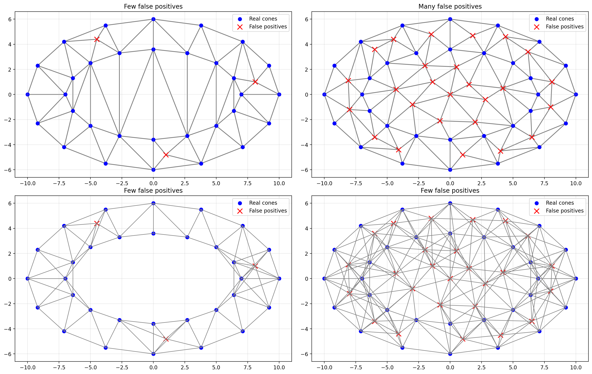

# Delaunay vs Radius-Based Cone Graph

A small Python visualization comparing two graph-construction methods
for an autonomous racing cone map:

1. Delaunay triangulation
2. Radius-based connection graph

The experiment compares both methods under two conditions:

- Few false-positive cone detections
- Many false-positive cone detections

## Motivation

In autonomous racing path planning, detected cones can be represented as
vertices of a graph. False-positive detections affect the connectivity of
this graph differently depending on the graph-construction method.

Delaunay triangulation produces a planar and relatively sparse graph.
The radius-based method connects every pair of cones whose distance is
below a predefined threshold, potentially creating a very dense graph
when many false positives are present.

## Implementation

The Delaunay triangulation is calculated using scipy.spatial.Delaunay.

The radius-based graph construction is implemented manually by checking
the Euclidean distance between every pair of points and adding an edge
when the distance is smaller than the selected radius.

## Result



## Run

Install the dependencies:

```bash
pip install -r requirements.txt